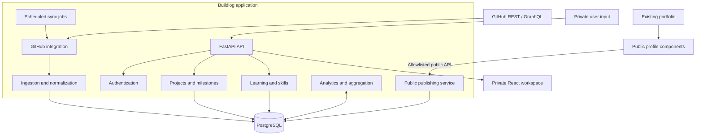

# Buildlog — Architecture

**Status:** Proposed V1 baseline  
**Style:** API-first modular monolith  
**Primary language:** Python

## 1. Goals

- Keep V1 straightforward to build, test, deploy, and operate.
- Separate business domains inside one backend.
- Treat GitHub as an external source, not the application database.
- Preserve source provenance and sync history.
- Serve private workspace and public portfolio through separate authorization paths.
- Allow later worker/webhook processing without changing domain boundaries.

## 2. Technology choices

| Layer | Choice |
|---|---|
| Frontend | React + TypeScript |
| Styling | Tailwind CSS |
| Backend | FastAPI + Pydantic |
| ORM / migrations | SQLAlchemy 2.x / Alembic |
| Database | PostgreSQL |
| GitHub | REST API + selective GraphQL |
| Jobs | APScheduler initially |
| Charts | Recharts |
| Runtime | Docker |
| Tests | pytest + HTTPX + frontend test runner |

Use one PostgreSQL database initially. Do not introduce a warehouse or distributed infrastructure until scale or requirements justify it.

## 3. Logical architecture



## 4. Backend module boundaries

```text
backend/
  app/
    api/v1/routes/
    core/                 # config, database, security, logging
    models/
    schemas/
    modules/
      projects/
      milestones/
      learning/
      skills/
      github/             # client, auth, repository/commit/PR/issue sync
      ingestion/          # normalization, deduplication, checkpoints
      analytics/
      timeline/
      experiments/
      journal/
      publishing/
    jobs/
    main.py
  alembic/
  tests/
```

Keep route handlers thin. Put business rules in services and database operations behind repositories or clearly defined query modules.

## 5. GitHub ingestion flow

1. Scheduler selects connected account and enabled repository mappings.
2. GitHub client requests data with least-privilege credentials.
3. Apply pagination and rate-limit handling.
4. Normalize payloads into internal schemas.
5. Deduplicate using repository IDs, commit SHAs, PR IDs/numbers, and issue IDs/numbers.
6. Upsert records and advance sync checkpoints.
7. Aggregate daily metrics.
8. Dashboard reads aggregate endpoints rather than repeatedly scanning raw event tables.

Jobs must be idempotent. Record status, timestamps, fetched/inserted/updated/skipped counts, and error details. Retry with bounded exponential backoff and respect GitHub rate-limit reset information.

For webhooks later: verify `X-Hub-Signature-256`, persist delivery IDs, reject duplicate deliveries, acknowledge quickly, process asynchronously, and periodically reconcile with the API.

## 6. Security

- Authenticate private workspace routes.
- Prefer secure HTTP-only, SameSite cookies for browser sessions.
- Apply CSRF protection for cookie-authenticated state changes.
- Encrypt GitHub credentials at rest; keep keys outside the database.
- Never return tokens in API responses or logs.
- Use environment variables or a secret manager for secrets.
- Verify webhook signatures and rate-limit sensitive endpoints.
- Enforce ownership checks on every private resource.
- Keep public endpoints read-only and return allowlisted fields only.
- Use HTTPS in production.
- Do not ingest employer-confidential systems or data.

## 7. API conventions

Prefix: `/api/v1`. JSON bodies, UTC ISO-8601 timestamps, stable internal IDs, external GitHub IDs, pagination, consistent errors, and FastAPI OpenAPI documentation.

Suggested endpoints:

| Method | Endpoint | Purpose |
|---|---|---|
| GET | `/dashboard/overview` | Private overview |
| GET/POST | `/projects` | List/create projects |
| GET/PATCH/DELETE | `/projects/{id}` | Project management |
| GET/POST | `/projects/{id}/milestones` | Milestones |
| GET | `/projects/{id}/activity` | Project activity |
| GET | `/github/repositories` | Connected repositories |
| POST | `/github/sync` | Trigger sync |
| GET | `/github/contributions` | Contribution calendar |
| GET/POST | `/learning/logs` | Learning records |
| GET | `/analytics/weekly` | Weekly metrics |
| GET | `/timeline` | Engineering timeline |
| GET | `/public/profile` | Public profile |
| GET | `/public/projects` | Published projects |
| POST | `/webhooks/github` | Verified webhook receiver |

## 8. Portfolio integration

The existing portfolio is a separate frontend consumer:
- Inspect its router and design tokens before changing it.
- Add a `/buildlog` route or equivalent.
- Reuse existing typography, spacing, colors, navigation, and responsive behavior.
- Provide loading, empty, and error states.
- Fetch only from the public API.
- Add integration tests and caching where appropriate.
- Do not embed private workspace routes or credentials in the public site.

## 9. Observability and deployment

Log request IDs, endpoint latency, job IDs, sync outcomes, API status/rate-limit metadata, record counts, and aggregation failures. Never log tokens, cookies, secrets, or private notes.

V1 topology: frontend static hosting/container, FastAPI container, PostgreSQL, one scheduled worker, HTTPS reverse proxy. Use Docker Compose locally. If multiple backend instances run, do not let every instance start an uncoordinated in-process scheduler; use one worker or a durable queue.
