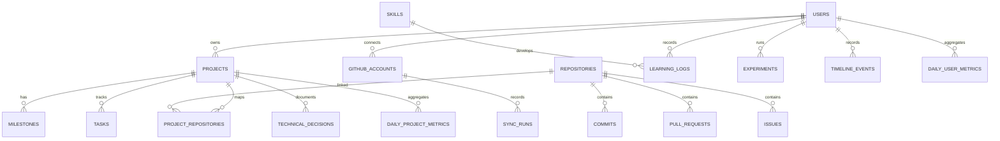

# Buildlog — Database Design

**Database:** PostgreSQL  
**ORM:** SQLAlchemy 2.x  
**Migrations:** Alembic  
**Status:** Proposed logical schema for V1

## 1. Design rules

- UUID internal primary keys.
- Retain stable external GitHub IDs and enforce unique constraints.
- Use `timestamptz` and store timestamps in UTC.
- Preserve source provenance and sync metadata.
- Keep activity records separate from outcome records.
- Calculate project progress from weighted milestones, not commit volume.
- Publish only explicitly approved fields through allowlisted API models.
- Add indexes for real query patterns; avoid indexing every column.

## 2. Identity and connections

### users
`id UUID PK`, `email UNIQUE`, `display_name`, `password_hash` or external identity reference, `timezone` (default Asia/Kolkata), `created_at`, `updated_at`.

### github_accounts
`id UUID PK`, `user_id FK`, `github_user_id BIGINT UNIQUE`, `login`, `encrypted_access_token`, `token_scopes JSONB`, `connected_at`, `last_validated_at`, `is_active`.

Never store plaintext tokens. Keep encryption key material outside PostgreSQL.

## 3. Projects and planning

### projects
`id UUID PK`, `user_id FK`, `name`, `slug`, `category`, `description`, `status` (idea/planned/active/paused/completed/archived), `visibility` (private/public), `is_published BOOLEAN DEFAULT FALSE`, `started_on`, `target_date`, `completed_at`, timestamps. Unique `(user_id, slug)`.

### repositories
`id UUID PK`, `github_repository_id BIGINT UNIQUE`, `owner_login`, `name`, `full_name`, `default_branch`, `visibility`, `is_archived`, `html_url`, `last_synced_at`, timestamps.

### project_repositories
`project_id FK`, `repository_id FK`, `is_primary`, `created_at`. Composite unique `(project_id, repository_id)`.

### milestones
`id UUID PK`, `project_id FK`, `title`, `description`, `weight NUMERIC(8,2) > 0`, `status` (planned/in_progress/completed/cancelled), `due_date`, `completed_at`, `sort_order`, timestamps.

Progress = completed eligible milestone weight / total eligible milestone weight × 100. Exclude cancelled milestones. If no eligible milestones exist, show “not yet measured”, not zero.

### tasks
`id UUID PK`, `project_id FK`, `milestone_id nullable FK`, `title`, `description`, `status` (todo/in_progress/blocked/done/cancelled), `priority`, `due_date`, `completed_at`, timestamps.

## 4. GitHub activity and synchronization

### commits
`id UUID PK`, `repository_id FK`, `sha CHAR(40)`, `author_github_id nullable`, `author_name`, `author_email`, `committer_name`, `committed_at`, `message`, `html_url`, `is_user_authored BOOLEAN`, optional `source_payload JSONB`, `ingested_at`. Unique `(repository_id, sha)`.

Author identity matching must be explicit and reviewable because commit email may differ from the GitHub account's verified email.

### pull_requests
`id UUID PK`, `repository_id FK`, `github_pr_id BIGINT UNIQUE`, `number`, `title`, `state`, `author_github_id`, `created_at_github`, `updated_at_github`, `merged_at`, `closed_at`, `html_url`, `is_user_authored`, `ingested_at`. Unique `(repository_id, number)`.

### issues
`id UUID PK`, `repository_id FK`, `github_issue_id BIGINT UNIQUE`, `number`, `title`, `state`, `author_github_id`, `created_at_github`, `updated_at_github`, `closed_at`, `html_url`, `is_user_authored`, `ingested_at`. Unique `(repository_id, number)`.

### pull_request_reviews
`id UUID PK`, `repository_id FK`, `github_review_id BIGINT UNIQUE`, `pr_number`, `reviewer_github_id`, `state`, `submitted_at`, `html_url`.

### sync_runs
`id UUID PK`, `github_account_id FK`, `repository_id nullable FK`, `sync_type`, `status` (running/succeeded/partial/failed), `started_at`, `finished_at`, `fetched_count`, `inserted_count`, `updated_count`, `skipped_count`, `error_summary`, `rate_limit_remaining`, `created_at`.

### sync_checkpoints
`id UUID PK`, `repository_id FK`, `resource_type`, `cursor` or `since_timestamp`, `last_successful_sync_at`, `updated_at`. Unique `(repository_id, resource_type)`.

## 5. Learning and skills

### skills
`id UUID PK`, `user_id FK`, `name`, `category`, `description`, `created_at`. Unique `(user_id, name)`.

### learning_tracks
`id UUID PK`, `user_id FK`, `name`, `description`, `status`, `visibility`, timestamps.

### learning_logs
`id UUID PK`, `user_id FK`, `learning_track_id nullable FK`, `skill_id nullable FK`, `project_id nullable FK`, `title`, `notes`, `duration_minutes`, `activity_date`, `evidence_level` (explored/practiced/applied/demonstrated), timestamps.

### learning_resources
`id UUID PK`, `user_id FK`, `learning_track_id nullable FK`, `title`, `url`, `resource_type`, `status`, `created_at`.

## 6. Journal, experiments, and timeline

### technical_decisions
`id UUID PK`, `project_id FK`, `title`, `context`, `decision`, `alternatives`, `consequences`, `decided_at`, `visibility`, timestamps.

### experiments
`id UUID PK`, `user_id FK`, `project_id nullable FK`, `title`, `hypothesis`, `objective`, `time_budget_minutes`, `technologies JSONB`, `findings`, `limitations`, `outcome` (successful/failed/inconclusive/ongoing), `next_decision` (abandon/revisit/promote), `visibility`, timestamps.

### timeline_events
`id UUID PK`, `user_id FK`, `project_id nullable FK`, `event_type`, `source_type` (github/manual/system), `source_external_id nullable`, `title`, `summary`, `occurred_at`, `visibility`, `metadata JSONB`, `created_at`. Add uniqueness for non-null source identifiers.

### weekly_reviews
`id UUID PK`, `user_id FK`, `week_start`, `accomplishments`, `blockers`, `lessons_learned`, `next_week_priorities`, `ai_draft nullable`, `approved_at nullable`, `visibility`, timestamps. Unique `(user_id, week_start)`.

## 7. Analytics

### daily_project_metrics
`id UUID PK`, `project_id FK`, `metric_date DATE`, `user_authored_commits`, `pull_requests_opened`, `pull_requests_merged`, `issues_opened`, `issues_closed`, `reviews_submitted`, `learning_minutes`, `milestones_completed`, `calculated_at`. Unique `(project_id, metric_date)`.

### daily_user_metrics
`id UUID PK`, `user_id FK`, `metric_date DATE`, `user_authored_commits`, `pull_requests_opened`, `pull_requests_merged`, `issues_opened`, `reviews_submitted`, `learning_minutes`, `active_projects_count`, `calculated_at`. Unique `(user_id, metric_date)`.

## 8. Public publishing

### public_profile
`id UUID PK`, `user_id FK UNIQUE`, `is_enabled`, `display_name`, `headline`, `bio`, `updated_at`.

### public_project_settings
`id UUID PK`, `project_id FK UNIQUE`, `is_published`, `public_summary`, `show_repository_link`, `show_activity`, `show_milestones`, `published_at`, `updated_at`.

A project-level flag must not automatically expose all nested records. Publish only fields explicitly approved.

## 9. Relationships

## 10. Indexes and metric definitions

Recommended indexes:
- `commits(repository_id, committed_at DESC)`
- `commits(author_github_id, committed_at DESC)`
- `pull_requests(repository_id, updated_at_github DESC)`
- `issues(repository_id, updated_at_github DESC)`
- `timeline_events(user_id, occurred_at DESC)`
- `learning_logs(user_id, activity_date DESC)`
- `daily_project_metrics(project_id, metric_date DESC)`
- `daily_user_metrics(user_id, metric_date DESC)`
- `sync_runs(github_account_id, started_at DESC)`

Personal contribution counts require verified user identity matching. Keep PRs authored, PRs merged, reviews submitted, and issues created/closed as separate metrics. Learning time is user-entered; never infer it from commits. Consistency metrics must have a transparent definition.

A future analytical star schema may add facts for commit, learning, and project progress plus date, project, repository, and skill dimensions. V1 daily aggregates are sufficient.
